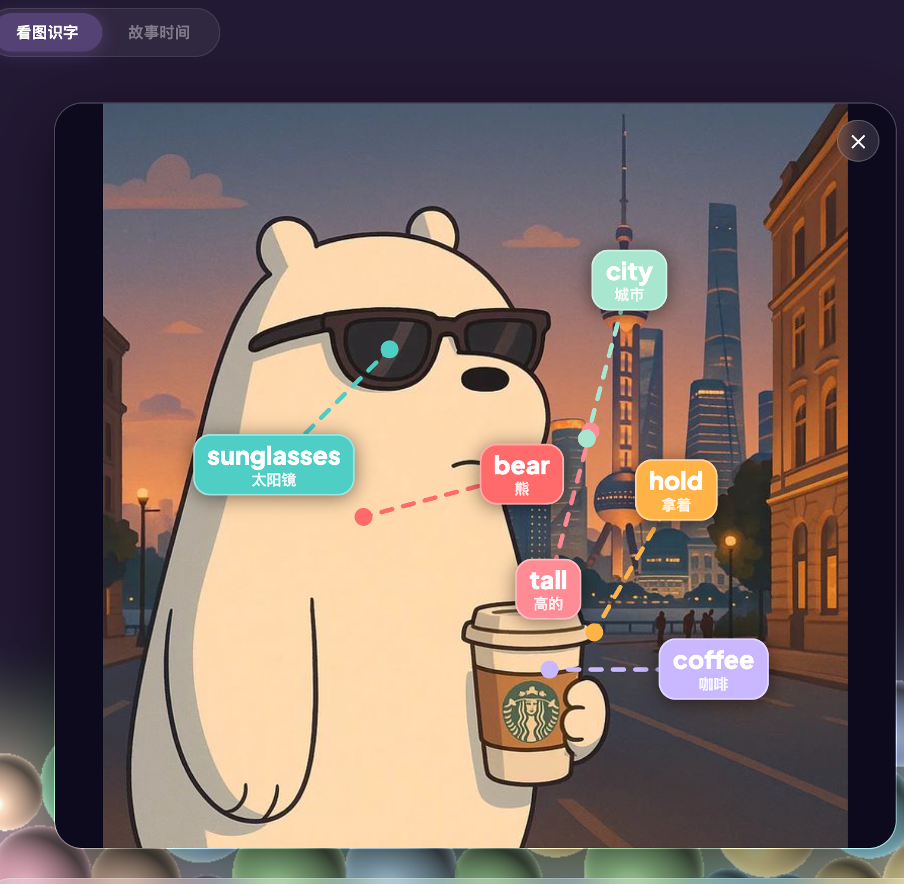
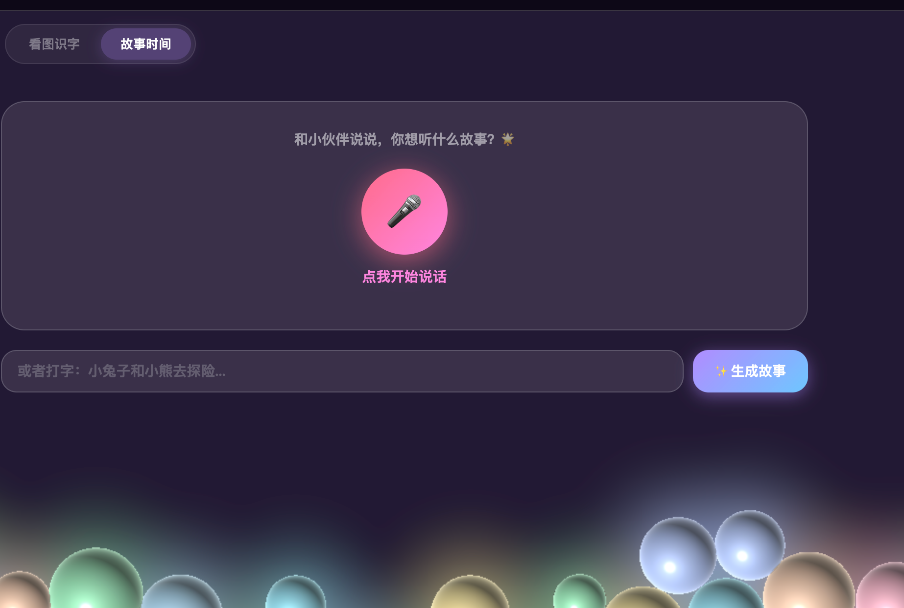

# 英语小伙伴 · English Buddy

**中文** | [English](#english)

上传一张图片，AI 像老师一样读懂它，把单词直接标注在图片上——不是「猫 cat」这种枯燥学法，而是在你喜欢的图里认识 sunglasses、melancholic、reverie。还能用声音告诉 AI 你想听什么故事，TA 会生成一段英文故事并朗读给你。

**在线体验 → https://xiaonizhou-crypto.github.io/english-buddy/**

<table>
<tr>
<td></td>
<td></td>
</tr>
<tr>
<td align="center">看图识字 — 词汇标注在图上</td>
<td align="center">故事时间 — 说出主题生成故事</td>
</tr>
</table>

---

## 功能

### 看图识字
- 上传任意图片（照片 / 插画 / 截图都行）
- Gemini AI 识别图中内容，提取 6 个场景词汇
- 词汇卡片直接**叠加在图片对应位置**，连线指向物体
- 每个词卡显示：英文单词 + 中文释义
- 点击词卡 → 浏览器即时读音（Web Speech API，零延迟）
- 底部词汇表：音标、词性、中文、例句全部展示

### 故事时间
- 点麦克风，用中文或英文说出故事主题（如「小兔子和小熊去探险」）
- 或直接在输入框打字
- Gemini 生成一段适合儿童的英文故事
- 自动 TTS 朗读，温柔男声（Umbriel 声线）

## 使用方法

1. 浏览器直接打开 `index.html`，无需安装
2. 点右上角 🔑，输入 [Gemini API Key](https://aistudio.google.com/apikey)（免费获取）
3. **看图识字**：拖入图片 → 点「分析图片」→ 点词卡听发音
4. **故事时间**：点麦克风说故事主题，或打字 → 点「✨ 生成故事」

## 技术栈

| 技术 | 用途 |
|---|---|
| **Gemini 2.5 Flash** | 图像分析 + 词汇提取（JSON schema 输出） |
| **Gemini 2.5 Flash TTS**（Umbriel 声线） | 故事语音朗读 |
| **Web Speech API** | 词汇即时读音 + 语音输入识别 |
| **Caveat**（Google Fonts） | 手写粉笔风词卡字体 |
| **原生 HTML / CSS / JS** | 零依赖，单文件，无需构建 |

---

## English

# English Buddy · 英语小伙伴

Upload any photo. Gemini reads it like a teacher, then overlays vocabulary cards directly on your image — not boring "cat 猫" drills, but real words from pictures you love. Plus a story generator: speak a theme, get a beautiful English story read aloud.

**Live demo → https://xiaonizhou-crypto.github.io/english-buddy/**

## Features

### Picture Vocabulary
- Upload any image — photo, illustration, screenshot, anything
- Gemini AI identifies the scene and extracts **6 contextual vocabulary words**
- Word cards **overlay directly on the image**, with dashed lines pointing to objects
- Each card shows: English word + Chinese translation
- Tap any card → instant pronunciation via Web Speech API (zero delay)
- Glossary below the image: phonetic transcription, part of speech, translation, example sentence

### Story Time
- Tap the microphone and speak a story theme in Chinese or English
- Or type it in the input box
- Gemini generates a short, child-friendly English story
- Auto-plays as TTS narration in a warm, gentle voice (Umbriel)

## How to use

1. Open `index.html` in any modern browser — no install needed
2. Click 🔑 in the top right and enter your [Gemini API Key](https://aistudio.google.com/apikey) (free)
3. **Picture Vocab**: drag & drop an image → click「分析图片」→ tap word cards to hear pronunciation
4. **Story Time**: tap the mic and speak a theme, or type it → click「✨ 生成故事」

## Stack

| Tech | Use |
|---|---|
| **Gemini 2.5 Flash** | Image analysis + vocabulary extraction (JSON schema output) |
| **Gemini 2.5 Flash TTS** (Umbriel voice) | Story narration audio |
| **Web Speech API** | Instant word pronunciation + voice input |
| **Caveat** (Google Fonts) | Handwritten chalk-style word card font |
| **Vanilla HTML / CSS / JS** | Zero dependencies, single file, no build step |

## License

MIT
